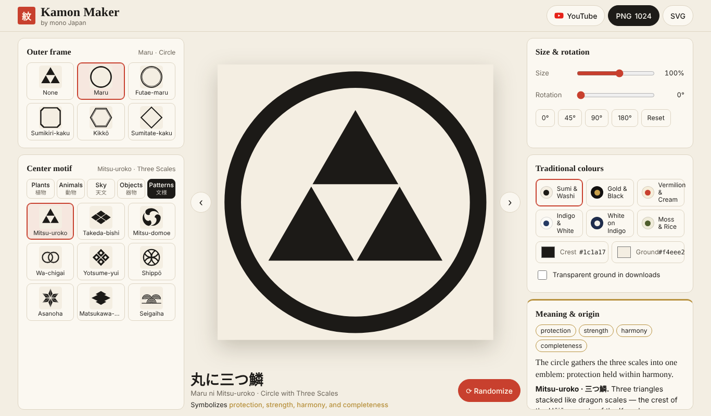

# Kamon Maker — Japanese Family Crest Generator

*by [mono Japan](https://www.youtube.com/@mono_Japan)* — documentaries on Japanese culture, aesthetics and philosophy

Design your own Japanese family crest (*kamon*) in the browser. Pick an outer frame and a center motif, adjust size, rotation and traditional colours, read what your combination symbolizes, and download it as a 1024×1024 PNG or a scalable SVG.

**Live demo:** https://elkinostudio.github.io/kamon-maker/



## Features

- **6 outer frames** — None, Maru (Circle), Futae-maru (Double Circle), Sumikiri-kaku (Cut-corner Square), Kikkō (Tortoise Shell), Sumitate-kaku (Diamond Square)
- **103 center motifs in 7 categories** — Flowers, Leaves & Trees, Animals, Sky & Nature, Objects, Patterns — all drawn as original vector artwork — plus **Modern**: 12 original crest-style designs (cat, shiba, fox, owl, koi, whale, Mount Fuji and more) and an **Initial** crest for any letter A–Z, clearly marked as new creations rather than traditional family crests
- **Size, rotation and position** controls — nudge any motif left, right, up or down
- **Combine two motifs** — add a second motif, then size and place it freely (e.g. a cherry blossom with a crescent moon)
- **Traditional colour presets** plus free colour pickers, with an optional transparent background
- **Meaning & origin card** that describes your combination in English
- **Randomize** with one tap
- **Share link** — copy a link or post on X; whoever opens it sees your exact crest
- **Download** as PNG (1024×1024, ideal for social media icons) or SVG
- **One screen, no scrolling** — tabbed tool tray on phones, three-column workbench on desktop
- Keyboard: ← → change motif, ↑ ↓ change frame, R randomizes

## Support

Kamon Maker is free. If you enjoy it, you can support the work on [Ko-fi](https://ko-fi.com/monojapan), or watch [the mono Japan film on kamon](https://youtu.be/bn1kcLV0_m4).

## Run locally

It is a single HTML file with no build step. Open `index.html` in a browser, or serve the folder:

```
python3 -m http.server 8000
```

React 18 and htm load from public CDNs (cdnjs, unpkg); fonts load from Google Fonts.

## About the meanings

The symbolic readings are traditional associations, not fixed rules. Historical notes (clans, shrines) were checked against published sources; crests you make here are original designs, not registered family mon.
